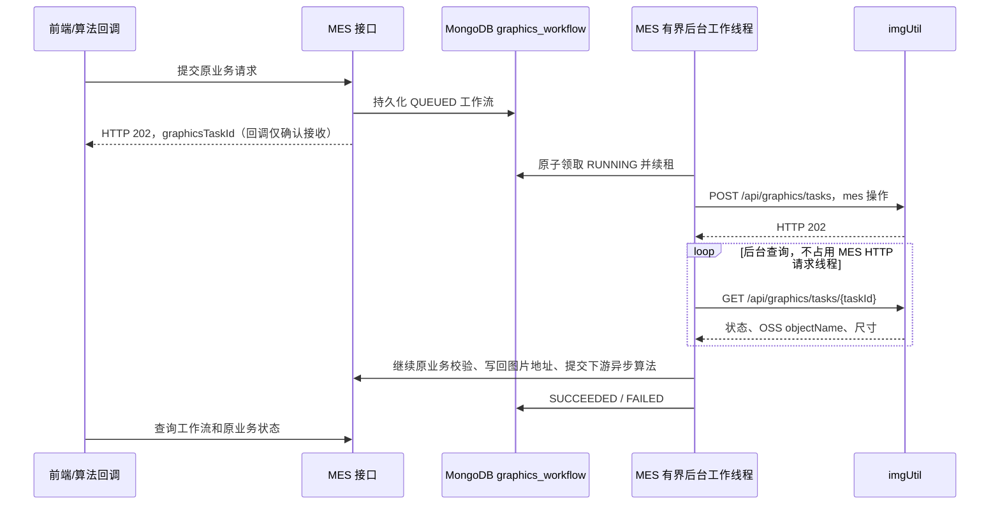

# MES 图形服务异步接口与接入说明

本次将 MES 的 PNG、专用文字标签、条纹/定位标记和 SVG 蒙版/编辑迁移至 `craftstudio-mes-imgUtil`。MES 保留工艺判断、几何参数规划、订单和生产片写入；大画布分配、字体测量/富文本绘制、PNG 编码、裁剪旋转及 SVG 重构由独立服务执行。

图形服务必须升级为包含 `mes` 兼容操作的版本，`GET /api/graphics/capabilities` 的 mesCompatibilityVersion 应为 1。旧版仅有 raster/svg 原语，不能直接承载现有生产标签。原有抠图、出血、彩白彩、套料、制版算法接口保持原职责。

## 一、整体流程



**工作流 SUCCEEDED 表示 MES 这一阶段执行成功。排版、制版等仍需等待原下游算法回调，不代表生产文件已经全部生成。** `result` 保存原业务返回值，可继续通过原查询接口查看最终业务状态。

首版使用两个有限后台线程轮询远程图形任务。这些线程会等待网络结果，但 HTTP 请求和算法回调线程不等待绘图；不使用无界线程池，也不在图形服务故障时回退到 MES 本地绘图。

## 二、已有接口变化

以下接口保留原请求体与 MES Authorization 鉴权：

| 接口/入口 | 新行为 |
| --- | --- |
| `POST /api/manufacturerSide/typesetting/toLayout` | HTTP 202，原 LayoutConfirmResult 增加 graphicsTaskId |
| `POST /api/manufacturerSide/typesetting/confirmLayout` | 同上 |
| `POST /api/manufacturerSide/typesetting/confirmPrint` | HTTP 202，原 ConfirmPrintResult 增加 graphicsTaskId |
| 批量确认排版/打印 | HTTP 202，返回父工作流编号；查询结果包含逐项结果 |
| `POST /api/manufacturerSide/productionPiece/increasePendingTypesettingQuantity` | HTTP 202，data 改为工作流描述，完成后 result 为 ProductionPiece |
| `POST /api/manufacturerSide/productionPiece/batchRedo` | HTTP 202，data 改为工作流描述，完成后 result 为 ProductionPiece 列表 |
| 订单预处理队列 | 按 orderItemId/preprocessRequestId 持久化图形阶段，后台读取最新订单项；过期、退单请求跳过 |
| `/order/callback/generate_mask_files` | 持久化回调后立即确认接收，后台完成标记/留白并写入生产片 |
| `/typesetting/callback/generate_nested_files`、`generate_grid_nested_files` | 持久化回调后确认接收，后台清理镜像 SVG 并执行原回调逻辑 |

批量确认路径分别为 `/confirmLayout/batch` 和 `/confirmPrint/batch`（同一 typesetting 前缀）。下面给出新增查询接口。回调成功只表示已持久化接收，不表示回调处理已经完成。重复回调按内容幂等，失败工作流不会因同一回调重发而重复执行，应查询后手动重试。

排版类接收示例：

```json
{
  "code": 200,
  "message": "success",
  "data": {
    "success": true,
    "graphicsTaskId": "1eaa39a4-a331-4284-91ad-764cffcf22f9",
    "message": "图形工作流已接收，请查询工作流状态；尚未完成排版或制版"
  }
}
```

注意区分 HTTP 状态 202、MES 响应包装 code=200、data.success=true：此时只代表接收成功。前端不能立即提示“已完成排版/已下发打印”。

单次排版/确认类请求可携带 `X-Graphics-Request-Id`。同一工厂、操作及编号的相同请求复用原工作流，不同参数返回 HTTP 409。未提供时生成新工作流。批量最多 100 项，不允许跨工厂；包含失败项时父工作流为 FAILED，并保留逐项 result。

## 三、查询工作流

```http
GET /api/manufacturerSide/graphics/workflows/{graphicsTaskId}?manufacturerMetaId={factory}
Authorization: Bearer {MES登录令牌}
```

必须提供任务所属 manufacturerMetaId，登录令牌必须属于该工厂。已有 MES 默认 Authorization 的内部调用方式继续适用。

```json
{
  "code": 200,
  "message": "success",
  "data": {
    "graphicsTaskId": "1eaa39a4-a331-4284-91ad-764cffcf22f9",
    "manufacturerMetaId": "factory",
    "kind": "CONFIRM_LAYOUT",
    "businessId": "印版记录ID",
    "status": "SUCCEEDED",
    "createdAt": "按 MES 既有日期序列化配置输出",
    "updatedAt": "按 MES 既有日期序列化配置输出",
    "result": {"success":true,"message":"确认排版任务已提交，等待回调"},
    "error": null
  }
}
```

| 状态 | 含义 |
| --- | --- |
| QUEUED | 已持久化，等待工作线程 |
| RUNNING | 后台执行中，包括等待 imgUtil |
| SUCCEEDED | 本阶段业务执行完成；后续排版/制版回调另行查询 |
| FAILED | 图形或业务校验失败，error 为原因 |
| RECOVERY_REQUIRED | 执行实例失联，可能已产生部分业务写入，需核对后重试 |

建议前端每 1–2 秒查询，设置页面等待上限，允许关闭页面后重新进入查询。工作流 payload、内部 owner 和凭据不在查询接口返回。

按业务对象查询最近 100 条：

```http
GET /api/manufacturerSide/graphics/workflows?manufacturerMetaId={factory}&businessId={id}
```

订单预处理/抠图回调 businessId 是 orderItemId；确认排版/打印是 TypesettingInfo.id；套料回调是算法返回的 typesettingId；重做是 productionPieceId；批量请求的 businessId 为 `batch`。

## 四、失败重试

```http
POST /api/manufacturerSide/graphics/workflows/{graphicsTaskId}/retry?manufacturerMetaId={factory}
Authorization: Bearer {MES登录令牌}
```

仅 FAILED 或 RECOVERY_REQUIRED 可重试，返回 HTTP 202 和新的工作流描述。旧任务保留。**先核对订单/印版当前状态及已有结果；批量请求只重提失败项，避免重新执行已成功项。** 原有生产状态锁和过期回调校验继续生效。

工作流排队数据保存在 MongoDB，MES 重启后 QUEUED 会继续领取。RUNNING 采用 120 秒租约、每 15 秒续租；失联任务转为 RECOVERY_REQUIRED，不盲目重放可能已提交的生产写入。终态工作流保留 7 天后由 MongoDB TTL 清理。

网络不确定、imgUtil 429/503 时，客户端在配置的等待期限内使用同一远程 taskId 退避重试。图形任务明确 FAILED/TIMED_OUT 后，MES 工作流失败；不会把不完整资源写成成功结果，也不会在 MES 本地重画。

## 五、MES → imgUtil 协议

提交：`POST /api/graphics/tasks`，请求头 `X-Api-Key`，示例：

```json
{
  "requestId":"mes-工作流UUID去连字符-参数摘要",
  "mes":{
    "operation":"LIUBAI_BORDER",
    "parameters":{
      "width":1000,"height":2000,
      "left":20,"right":20,"top":20,"bottom":20,
      "strokeScale":1,"borderColor":-16777216,"innerBorder":true,"dashedInset":0
    }
  }
}
```

查询 `GET /api/graphics/tasks/{taskId}`，成功后获取 `artifact.objectName / width / height`；MES 组合 OSS URL 回写业务对象。SVG 片段、SVG 编辑结果通过受鉴权的 artifact 接口读取，MES 限制结果文本为 1MiB；PNG 不下载到 MES，也不携带位图字节。

| operation | 参数约定及用途 |
| --- | --- |
| BLACK | width/height 为原有像素值，不擅自做 DPI 换算 |
| STRIPES_PX | 像素宽高，color 为 Java ARGB 整数，逐像素交替条纹 |
| SPLICE_TEXT | width/height 为 mm，沿用 300 DPI 拼接文字规则 |
| MARK_TEXT / MARK_TWO_LINES | width/height 为 px，保留旧单行及旋转双色文字规则 |
| TRANSFORM | sourceTaskId、angle、cropWidth；仅处理图形服务自己的已成功 PNG；rounding 可为 FLOOR |
| LIUBAI_BORDER | 原尺寸 mm、四边边距、strokeScale、innerBorder、dashedInset、borderColor；沿用 36 DPI |
| LIUBAI_TAG | text、edgeSize(mm)、colors(ARGB数组)、fontScale；沿用 300 DPI、分段颜色、原字号规则 |
| CIRCLE_TAG / CROSS_TAG / DOUBLE_TAG | elementA、elementAExtInfos、commonOrderId、elementB、qrDataUri、stripWidth/stripHeight(mm)、rotate180；圆/十字另有 tagContentMaxWidth、hasRedoProductionPiece |
| CAIFU_TAG | elementA、stripWidth(mm)、rotate180，保留开背文字坐标 |
| SUBLIMATION_BORDER | width/height(mm)，沿用 36 DPI、最长边 4096px 和 2mm 黑边 |
| NESTING_MARKER / NESTING_MARKER_SVG | width、height=6、left，保留分隔线右侧 30mm 留白 |
| SVG_MASK / SVG_SAVE | 矩形蒙版生成 / 最终 SVG 验证保存 |
| LIUBAI_EXPAND / LIUBAI_GROUPS | source/原图引用、边距、标签资产和策略标志；保留负 viewBox 坐标及 require-plt |
| BUCKLE_APPEND / SPLICE_APPEND / SVG_RECT_GROUP | 追加扣点、拼接组及矩形标记，保留原 img 和工艺元数据 |
| SUB_OPEN / SUB_ORIGINAL / SUB_BACK / SUB_POINT / SUB_BORDER | 热升华 SVG 原语；反面只保留对应图片矩形 |
| SUB_CLEAN / SVG_REMOVE_SPLICE | 清理镜像工艺标记，保留排版位置和原图组 |
| SVG_RESIZE / SVG_REDO_ID | 材料根尺寸调整、重做首个匹配 ID 替换 |

专用标签沿用 MES 原绘图函数和常量，不用通用 LABEL 自动缩小规则替代。内部二维码传 `qr-content:` 加内容 UTF-8 Base64，由图形服务生成二维码、裁白边及合成；原独立二维码和物流二维码接口不属于本次四类工艺图形迁移。

SVG 兼容操作支持 MES 既有负 viewBox，不套用通用 EDIT 的零原点限制；仍拒绝脚本、外部实体、外部 CSS 及服务端资源抓取。参数不允许传 Java 类名或任意执行代码。

## 六、部署配置与顺序

1. 先部署新版 imgUtil，开启 OSS，确认 bucket/prefix 和 MES 访问权限。
2. 将生产实际使用的 `Source Han Sans SC VF` 等字体安装/挂载到图形服务。字体必须一致，否则字宽和换行可能不同。可配置 required-fonts，缺字库直接阻止启动。
3. 配置 MES 并重启；工作流首次启动自动创建集合索引。
4. 前端适配 HTTP 202、graphicsTaskId、查询和重试，再切换生产流量。上线前核对真实工艺样本。

MES 配置示例（合并进现有环境配置，不替换原配置）：

```yaml
graphics:
  imgutil:
    base-url: http://imgutil:8092
    api-key: ${GRAPHICS_API_KEY}
    artifact-base-url: https://your-bucket.oss-cn-hangzhou.aliyuncs.com
    poll-interval-ms: 500
    wait-timeout-ms: 180000
  workflow:
    workers: 2
    capacity: 1000
    poll-ms: 500
```

imgUtil 必须使用相同 API Key，配置 OSS_ENABLED=true 及服务端 OSS 凭据。OSS 端点与 artifact-base-url 必须对应同一存储桶，不传 STS 给绘图请求。

长标签使用 300 DPI，1500mm 宽约为 17717px，不能沿用 8192px 单边上限。建议按真实最大标签和内存预算配置，例如：

```text
GRAPHICS_MAX_DIMENSION=65536
GRAPHICS_MAX_PIXELS=16000000
GRAPHICS_WORKERS=1
GRAPHICS_FONT_DIRECTORY=/app/fonts
GRAPHICS_FONTS_HOST_DIRECTORY=./fonts
GRAPHICS_REQUIRED_FONTS=Source Han Sans SC VF
```

Compose 会将 GRAPHICS_FONTS_HOST_DIRECTORY 只读挂载到 /app/fonts；先创建该目录并放入授权的生产字体文件。裸机运行使用 GRAPHICS_FONT_DIRECTORY 指定字体目录。

该配置配合独立容器限额使用，超限明确失败，不自动降低生产分辨率。默认 512MiB 堆须通过真实标签压测后确认；不能只提高像素上限而不调整并发和内存预算。本地缓存有保留期，生产业务只持久化 OSS 地址，OSS 生命周期按生产文件要求另设。

## 七、错误码

| HTTP | 含义 |
| --- | --- |
| 202 | 已持久化接收，继续查询工作流 |
| 400 | 参数、跨工厂批量或重试状态无效 |
| 401 | MES 登录鉴权失败 |
| 404 | 工作流不存在/不属于指定工厂/已过期 |
| 409 | X-Graphics-Request-Id 冲突 |
| 429 | MES 工作流队列满，Retry-After=5 |
| 500 | 持久化等服务异常；不得当作已接收 |

后台失败通过查询结果 status/error 返回，不改变查询 HTTP 200。客户端取消页面等待不会取消已经持久化的生产工作流。


## 八、验证范围

两项目使用 Java 22 执行 Maven verify；图形服务包含像素、专用标签、负 viewBox、SVG 元数据、XML 安全与任务队列测试；MES 包含异步工作线程、远程提交/轮询、失败传播、并发幂等领取、租约失联恢复及已有业务测试。

当前构建环境无法访问原私有 Maven 仓库。MES 验证使用公开 shared 源码 98ef34a 和 pangolin 源码 91dcf03 本地构建的兼容依赖；仅在临时依赖副本中排除了本次不涉及且无法获取 SDK 的 Lakala 支付适配器，并将 pangolin 的 shared 依赖对齐 MES 使用的 1.2.1。这些依赖副本不提交、不用于生产发布。上线前须使用正式私库构件再次构建，并以真实 MongoDB/Redis、OSS 和生产字体联调。
