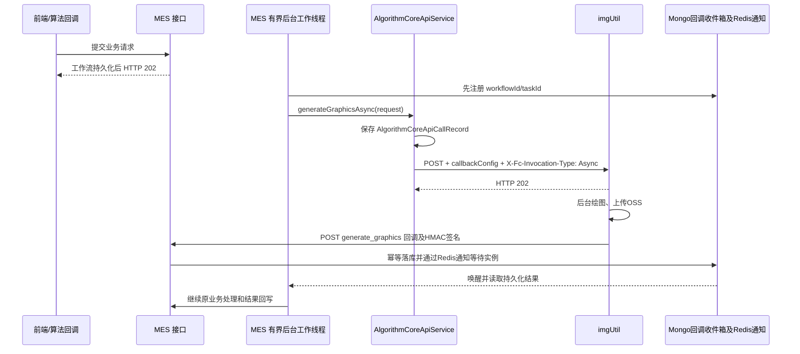

# MES 图形服务异步接口与接入说明

本次将 MES 的 PNG、专用文字标签、条纹/定位标记和 SVG 蒙版/编辑迁移至 `craftstudio-mes-imgUtil`。MES 保留工艺判断、几何参数规划、订单和生产片写入；大画布分配、字体测量/富文本绘制、PNG 编码、裁剪旋转及 SVG 重构由独立服务执行。

图形服务必须升级为包含 `mes` 兼容操作的版本，`GET /api/graphics/capabilities` 的 mesCompatibilityVersion 和 callbackProtocolVersion 都应为 1。旧版仅有 raster/svg 原语，不能直接承载现有生产标签。原有抠图、出血、彩白彩、套料、制版算法接口保持原职责。

## 一、整体流程



**工作流 SUCCEEDED 表示 MES 这一阶段执行成功。排版、制版等仍需等待原下游算法回调，不代表生产文件已经全部生成。** `result` 保存原业务返回值，可继续通过原查询接口查看最终业务状态。

MES 使用有限后台线程等待结果回调，不再 GET 轮询图形任务状态。后台线程等待期间仍占用工作流槽位，HTTP 业务请求和回调接收线程不等待绘图。结果先存入 MongoDB，再通过 Redis Pub/Sub 唤醒对应实例；通知丢失时，在等待期限结束后从持久化收件箱再读取一次。服务故障不会回退到 MES 本地绘图。

## 二、已有接口变化

以下接口保留原请求体与 MES Authorization 鉴权：

| 接口/入口 | 新行为 |
| --- | --- |
| `POST /api/manufacturerSide/typesetting/toLayout` | HTTP 202，原 LayoutConfirmResult 增加 graphicsTaskId |
| `POST /api/manufacturerSide/typesetting/confirmLayout` | 同上 |
| `POST /api/manufacturerSide/typesetting/confirmPrint` | HTTP 202，原 ConfirmPrintResult 增加 graphicsTaskId |
| 批量确认排版/打印 | HTTP 202，返回父工作流编号；查询结果包含逐项结果 |
| `POST /api/manufacturerSide/productionPiece/increasePendingTypesettingQuantity` | HTTP 202，data 改为工作流描述，完成后 result 为 ProductionPiece |
| `POST /api/manufacturerSide/productionPiece/batchRedo` | HTTP 202，data 改为工作流描述，完成后 result 为 ProductionPiece 列表 |
| 订单预处理队列 | 按 orderItemId/preprocessRequestId 持久化图形阶段，后台读取最新订单项；过期、退单请求跳过 |
| `/order/callback/generate_mask_files` | 持久化回调后立即确认接收，后台完成标记/留白并写入生产片 |
| `/typesetting/callback/generate_nested_files`、`generate_grid_nested_files` | 持久化回调后确认接收，后台清理镜像 SVG 并执行原回调逻辑 |

批量确认路径分别为 `/confirmLayout/batch` 和 `/confirmPrint/batch`（同一 typesetting 前缀）。下面给出新增查询接口。回调成功只表示已持久化接收，不表示回调处理已经完成。重复回调按内容幂等，失败工作流不会因同一回调重发而重复执行，应查询后手动重试。

排版类接收示例：

```json
{
  "code": 200,
  "message": "success",
  "data": {
    "success": true,
    "accepted": true,
    "status": "QUEUED",
    "graphicsTaskId": "1eaa39a4-a331-4284-91ad-764cffcf22f9",
    "message": "图形工作流已接收，请查询工作流状态；尚未完成排版或制版"
  }
}
```

注意区分 HTTP 状态 202、MES 响应包装 code=200、data.success=true：此时只代表接收成功。新增 data.accepted=true 和 data.status=QUEUED/RUNNING 明确表示尚未完成；前端必须继续查询 graphicsTaskId，不能立即提示“已完成排版/已下发打印”。兼容原 code=200 包装，最终业务结果以工作流 status/result/error 为准；查询接口 HTTP 200 仅表示查询成功。

入队前已统一执行只读业务预检：toLayout 的来源/数量/工厂归属、材料/工艺一致性、容器内缩及零件能否放入所选规格；确认排版/打印的记录、状态、模式、SVG/尺寸及设备存在性；重做的正数数量、零件存在性及待排版节点。批量请求先校验所有条目，任一已知错误都返回 HTTP 400，不创建父工作流。预检不占用数量、不写 Redis、不生成图形或提交算法；使用副本计算内缩，不改变原请求。后台执行仍在原锁内重新校验，排队后数据变化、绘图或算法故障仍会导致后续 FAILED。

同一 X-Graphics-Request-Id 的已有任务优先于重新校验和队列容量检查：QUEUED/RUNNING 返回原编号和 HTTP 202；SUCCEEDED 返回原编号、status=SUCCEEDED 和 HTTP 200；FAILED/RECOVERY_REQUIRED 返回 HTTP 409，message 含原任务编号和失败原因，不再包装为接收成功。失败重试走专用 retry 接口，重试前仍需核对已发生的业务写入。

单次排版/确认类请求可携带 `X-Graphics-Request-Id`。同一工厂、操作及编号的相同请求复用原工作流，不同参数返回 HTTP 409。未提供时生成新工作流。批量最多 100 项，不允许跨工厂；包含失败项时父工作流为 FAILED，并保留每项 id、success 和 message 等结果；运行时单项异常也保留其他条目的结果。

## 三、查询工作流

```http
GET /api/manufacturerSide/graphics/workflows/{graphicsTaskId}?manufacturerMetaId={factory}
Authorization: Bearer {MES登录令牌}
```

必须提供任务所属 manufacturerMetaId，登录令牌必须属于该工厂。已有 MES 默认 Authorization 的内部调用方式继续适用。

```json
{
  "code": 200,
  "message": "success",
  "data": {
    "graphicsTaskId": "1eaa39a4-a331-4284-91ad-764cffcf22f9",
    "manufacturerMetaId": "factory",
    "kind": "CONFIRM_LAYOUT",
    "businessId": "印版记录ID",
    "status": "SUCCEEDED",
    "createdAt": "按 MES 既有日期序列化配置输出",
    "updatedAt": "按 MES 既有日期序列化配置输出",
    "result": {"success":true,"message":"确认排版任务已提交，等待回调"},
    "error": null
  }
}
```

| 状态 | 含义 |
| --- | --- |
| QUEUED | 已持久化，等待工作线程 |
| RUNNING | 后台执行中，包括等待 imgUtil |
| SUCCEEDED | 本阶段业务执行完成；后续排版/制版回调另行查询 |
| FAILED | 图形或业务校验失败，error 为原因 |
| RECOVERY_REQUIRED | 执行实例失联，可能已产生部分业务写入，需核对后重试 |

建议前端每 1–2 秒查询，设置页面等待上限，允许关闭页面后重新进入查询。工作流 payload、内部 owner 和凭据不在查询接口返回。

按业务对象查询最近 100 条：

```http
GET /api/manufacturerSide/graphics/workflows?manufacturerMetaId={factory}&businessId={id}
```

订单预处理/抠图回调 businessId 是 orderItemId；确认排版/打印是 TypesettingInfo.id；套料回调是算法返回的 typesettingId；重做是 productionPieceId；批量请求的 businessId 为 `batch`。

## 四、失败重试

```http
POST /api/manufacturerSide/graphics/workflows/{graphicsTaskId}/retry?manufacturerMetaId={factory}
Authorization: Bearer {MES登录令牌}
```

仅 FAILED 或 RECOVERY_REQUIRED 可重试，返回 HTTP 202 和新的工作流描述。旧任务保留。**先核对订单/印版当前状态及已有结果；批量请求只重提失败项，避免重新执行已成功项。** 原有生产状态锁和过期回调校验继续生效。

工作流排队数据保存在 MongoDB，MES 重启后 QUEUED 会继续领取。RUNNING 采用 120 秒租约、每 15 秒续租；失联任务转为 RECOVERY_REQUIRED，不盲目重放可能已提交的生产写入。终态工作流保留 7 天后由 MongoDB TTL 清理。

提交或回调超时、图形错误结果会使 MES 工作流失败，按原重试接口使用新工作流编号重试。算法错误回调仍按“已持久化接收”返回2xx，后台处理后工作流记录 FAILED 及错误原因；蒙版处理落库失败状态也不会再被包装成 SUCCEEDED。重新投递同一失败回调只确认接收，不自动再次生成生产片。

图形服务会对回调投递失败进行持久化退避重试（最多10次），包括绘图失败、超时及服务重启中断结果；不会因回调失败重复绘图。

## 五、MES → imgUtil 协议

统一入口为 `AlgorithmCoreApiService.generateGraphicsAsync`，使用 `external.api.generateGraphicsUrl`。HTTP 请求头为 `Content-Type: application/json`、`X-Fc-Invocation-Type: Async` 和 `X-Api-Key`；API Key 仅放在请求头，不写入请求体和调用记录。示例：

```json
{
  "requestId":"mes-工作流UUID去连字符-参数摘要",
  "callbackConfig":{
    "callbackUrl":"http://MES地址:8081/api/manufacturerSide/graphics/callback/generate_graphics",
    "callbackCustomValue":{"id":"工作流UUID","workflowId":"工作流UUID","taskId":"与requestId相同"}
  },
  "mes":{
    "operation":"LIUBAI_BORDER",
    "parameters":{
      "width":1000,"height":2000,
      "left":20,"right":20,"top":20,"bottom":20,
      "strokeScale":1,"borderColor":-16777216,"innerBorder":true,"dashedInset":0
    }
  }
}
```

图形服务处理完成后，POST 到 `callbackConfig.callbackUrl`：

```json
{
  "id":"图形taskId",
  "status":"success",
  "result":{
    "taskId":"图形taskId",
    "artifact":{"objectName":"imgutil/taskId/result.png","width":8,"height":3,"mediaType":"image/png"}
  },
  "error":null,
  "errorCode":null,
  "callbackCustomValue":{"id":"工作流UUID","workflowId":"工作流UUID","taskId":"图形taskId"}
}
```

失败时 status=error，result=null，error/errorCode 表示原因。回调接口为 `POST /api/manufacturerSide/graphics/callback/generate_graphics`，不使用用户登录令牌，改为校验 `X-Graphics-Signature`：以相同的 GRAPHICS_API_KEY 为密钥，对原始 UTF-8 JSON 字节执行 HMAC-SHA256，得到小写十六进制签名。必须先验签再落库，重复相同结果幂等确认，未知关联或冲突结果拒绝。

MES 根据回调中的 artifact.objectName/width/height 继续业务。只有需要 SVG 文本时才 GET artifact 下载文件，限制1MiB；这不是任务状态查询。任务 GET 接口继续保留供人工排障，MES 不调用它轮询。

调用记录沿用 AlgorithmCoreApiCallRecord：mode=async、type=generateGraphicsAsync、sourceId=workflowId，并保存请求和 callbackCustomValue。MES 的 graphics_callback_inbox 先于提交注册关联，结果保留7天，解决快速回调、重复投递和实例间通知问题。图形服务 `GET /api/graphics/tasks/{taskId}/callback` 返回投递状态 PENDING/DELIVERED/FAILED、attempts、nextAttemptAt 和 lastError。

| operation | 参数约定及用途 |
| --- | --- |
| BLACK | width/height 为原有像素值，不擅自做 DPI 换算 |
| STRIPES_PX | 像素宽高，color 为 Java ARGB 整数，逐像素交替条纹 |
| SPLICE_TEXT | width/height 为 mm，沿用 300 DPI 拼接文字规则 |
| MARK_TEXT / MARK_TWO_LINES | width/height 为 px，保留旧单行及旋转双色文字规则 |
| TRANSFORM | sourceTaskId、angle、cropWidth；仅处理图形服务自己的已成功 PNG；rounding 可为 FLOOR |
| LIUBAI_BORDER | 原尺寸 mm、四边边距、strokeScale、innerBorder、dashedInset、borderColor；沿用 36 DPI |
| LIUBAI_TAG | text、edgeSize(mm)、colors(ARGB数组)、fontScale；沿用 300 DPI、分段颜色、原字号规则 |
| CIRCLE_TAG / CROSS_TAG / DOUBLE_TAG | elementA、elementAExtInfos、commonOrderId、elementB、qrDataUri、stripWidth/stripHeight(mm)、rotate180；圆/十字另有 tagContentMaxWidth、hasRedoProductionPiece |
| CAIFU_TAG | elementA、stripWidth(mm)、rotate180，保留开背文字坐标 |
| SUBLIMATION_BORDER | width/height(mm)，沿用 36 DPI、最长边 4096px 和 2mm 黑边 |
| NESTING_MARKER / NESTING_MARKER_SVG | width、height=6、left，保留分隔线右侧 30mm 留白 |
| SVG_MASK / SVG_SAVE | 矩形蒙版生成 / 最终 SVG 验证保存 |
| LIUBAI_EXPAND / LIUBAI_GROUPS | source/原图引用、边距、标签资产和策略标志；保留负 viewBox 坐标及 require-plt |
| SPLICE_PIECE | groupText、originalSvg、pieceMongoId、originalContentImg、marks(assetKey)；同一零件 PNG 素材、旋转、全部 SVG 标记和最终上传共1个任务，artifact.assets 返回8个素材对象名 |
| SPLICE_MARKS_APPEND | originalSvg、pieceMongoId、originalContentImg、marks 数组；同一零件所有 SVG 标记一次生成、合并并上传，直接返回最终 SVG artifact；最多32个标记 |
| BUCKLE_APPEND / SPLICE_APPEND / SVG_RECT_GROUP | 追加扣点、拼接组及矩形标记，保留原 img 和工艺元数据 |
| SUB_OPEN / SUB_ORIGINAL / SUB_BACK / SUB_POINT / SUB_BORDER | 热升华 SVG 原语；反面只保留对应图片矩形 |
| SUB_CLEAN / SVG_REMOVE_SPLICE | 清理镜像工艺标记，保留排版位置和原图组 |
| SVG_RESIZE / SVG_REDO_ID | 材料根尺寸调整、重做首个匹配 ID 替换 |

双面对裱的固定箭头作为独立 forme mark 提交（elementG），不会再放入 DOUBLE_TAG.qrDataUri。为兼容旧 MES，图形服务遇到旧版本使用的固定 basetag-leftarrow.png / basetag-rightarrow.png 地址时沿用原标签行为：跳过二维码位绘制，保留独立箭头 mark，不下载远程图片。其他 URL 仍不作为二维码输入；PNG data URI 和 qr-content 输入继续支持。圆形/十字标签继续传真实二维码内容。

专用标签沿用 MES 原绘图函数和常量，不用通用 LABEL 自动缩小规则替代。内部二维码传 `qr-content:` 加内容 UTF-8 Base64，由图形服务生成二维码、裁白边及合成；原独立二维码和物流二维码接口不属于本次四类工艺图形迁移。

SVG 兼容操作支持 MES 既有负 viewBox，不套用通用 EDIT 的零原点限制；仍拒绝脚本、外部实体、外部 CSS 及服务端资源抓取。参数不允许传 Java 类名或任意执行代码。

### 同一零件的拼接完整任务

MES 的 SuperWidthSpliceProcessService 现在只提交一个 `SPLICE_PIECE` 任务。条纹、黄色/灰色文字、横竖方向旋转、SVG 标记构建、合并和上传全部在图形服务的同一有界工作线程内执行。MES 不再为该零件分别提交 STRIPES_PX / SPLICE_TEXT / TRANSFORM / SVG_RECT_GROUP / SPLICE_MARKS_APPEND / SVG_SAVE。

每个任务按顺序生成8种素材并及时释放画布，内部不创建子任务，也不再次调用图形 HTTP 接口。全部 PNG 与 SVG 共用一个任务超时、一个本地任务目录和一个文件总大小上限，清理任务会清理整个目录。PNG 和 SVG 都上传成功后才回调成功；回调失败按原规则重试，不会重画。部分失败时 MES 不更新该零件的 mask 和 marks；已经上传的 OSS 对象按桶生命周期管理。

```json
{
  "requestId":"mes-piece-complete",
  "mes":{
    "operation":"SPLICE_PIECE",
    "parameters":{
      "groupText":"618#1-2",
      "artifactBaseUrl":"https://bucket.oss-cn-hangzhou.aliyuncs.com",
      "originalSvg":"<svg xmlns='http://www.w3.org/2000/svg' width='100' height='200'><path d='M0 0 H100 V200 H0 Z'/></svg>",
      "pieceMongoId":"piece-id",
      "originalContentImg":"https://bucket/image.tif",
      "marks":[
        {"id":"adhesive-splice-stripe-bottom-a-piece-id","assetKey":"stripe-horizontal","x":0,"y":180,"width":6,"height":1},
        {"id":"adhesive-splice-text-yellow-bottom-b-piece-id","assetKey":"yellow-horizontal","x":44,"y":192,"width":56,"height":8}
      ]
    }
  },
  "callbackConfig":{
    "callbackUrl":"http://MES地址:8081/api/manufacturerSide/graphics/callback/generate_graphics",
    "callbackCustomValue":{"id":"workflow-id","workflowId":"workflow-id","taskId":"mes-piece-complete"}
  }
}
```

artifactBaseUrl 由 MES 的 graphics.imgutil.artifact-base-url 自动填入，必须对应图形服务上传桶。groupText 为1–512字符；marks 最多32项，assetKey 可为 dark-horizontal、dark-vertical、stripe-horizontal、stripe-vertical、yellow-horizontal、yellow-vertical、gray-horizontal、gray-vertical。坐标、尺寸、ID 和工艺元数据沿用旧规则；MES 仍规划点位。已有拼接标记时不重复追加，使用空 marks 生成素材，MES 保留原 mask 引用。

成功回调仍返回 result.artifact，objectName 是最终 SVG；新增 assets 为上述8个 assetKey 到 OSS 对象名的映射。例如：

```json
{
  "objectName":"imgutil/mes-piece-complete/result.svg",
  "assets":{
    "dark-horizontal":"imgutil/mes-piece-complete/dark-horizontal.png",
    "dark-vertical":"imgutil/mes-piece-complete/dark-vertical.png",
    "stripe-horizontal":"imgutil/mes-piece-complete/stripe-horizontal.png",
    "stripe-vertical":"imgutil/mes-piece-complete/stripe-vertical.png",
    "yellow-horizontal":"imgutil/mes-piece-complete/yellow-horizontal.png",
    "yellow-vertical":"imgutil/mes-piece-complete/yellow-vertical.png",
    "gray-horizontal":"imgutil/mes-piece-complete/gray-horizontal.png",
    "gray-vertical":"imgutil/mes-piece-complete/gray-vertical.png"
  }
}
```

MES 收到同一次回调后，用 OSS 域名拼接所有对象名，回写 mask 和原有 superWidthSplice* marks 字段；不再下载 SVG 或另行上传。普通单文件任务不会新增空 assets 字段，兼容旧回调及持久化结果。

先部署图形服务，确认 capabilities 返回 `splicePieceVersion=1`，再部署 MES。无需新增配置；仍须启用 OSS。升级后新零件日志应为一次 `operation=SPLICE_PIECE`，而非逐素材提交。其他工艺仍可能独立请求，不能将整个订单的所有图形操作视为一个零件任务。

旧 SPLICE_MARKS_APPEND 继续兼容：它只批量处理 SVG 标记，参数仍为 marks 数组（每项使用 img，非 assetKey），最多32项；旧 SPLICE_APPEND / SVG_RECT_GROUP 也保留。

## 六、部署配置与顺序

1. 先部署新版 imgUtil，开启 OSS，确认 bucket/prefix 和 MES 访问权限。
2. 将生产实际使用的 `Source Han Sans SC VF` 等字体安装/挂载到图形服务。字体必须一致，否则字宽和换行可能不同。可配置 required-fonts，缺字库直接阻止启动。
3. 暂停新的图形业务提交，等待旧版 MES 的 RUNNING 工作流完成，再配置 MES 并重启；工作流首次启动自动创建集合索引。新版请求增加 callbackConfig，同编号的旧版请求不能直接改用新协议重发；中断任务核对业务写入后用新工作流编号重试。
4. 前端适配 HTTP 202、graphicsTaskId、查询和重试，再切换生产流量。上线前核对真实工艺样本。

MES 配置示例（合并进现有环境配置，不替换原配置；external 下的其他算法地址继续保留）：

```yaml
external:
  api:
    generateGraphicsUrl: http://imgutil:8092/api/graphics/tasks
  callbackApi:
    generate_graphics: http://MES可被图形服务访问的地址:8081/api/manufacturerSide/graphics/callback/generate_graphics

graphics:
  imgutil:
    api-key: ${GRAPHICS_API_KEY}
    artifact-base-url: https://your-bucket.oss-cn-hangzhou.aliyuncs.com
    wait-timeout-ms: 180000
  workflow:
    workers: 2
    capacity: 1000
    poll-ms: 500
```

新配置优先使用 external.api.generateGraphicsUrl；未设置时兼容旧 graphics.imgutil.base-url 拼接 /api/graphics/tasks。external.callbackApi.generate_graphics 必填，必须能从图形服务访问，不能误填图形服务自己的回环地址。原 graphics.imgutil.poll-interval-ms 已移除、不再生效，wait-timeout-ms 现在表示回调等待期限。

imgUtil 必须使用相同 API Key，配置 OSS_ENABLED=true 及服务端 OSS 凭据。OSS 端点与 artifact-base-url 必须对应同一存储桶，不传 STS 给绘图请求。

图形服务已移除画布单边尺寸、总像素和累计画布像素上限。旧 GRAPHICS_MAX_DIMENSION / GRAPHICS_MAX_PIXELS（graphics.max-dimension / graphics.max-pixels）不再生效，可删除；capabilities 返回 pixelLimitsEnabled=false，不再返回 maxDimension/maxPixels。长标签仍按原有300 DPI等生产参数绘制，例如：

```text
GRAPHICS_WORKERS=1
GRAPHICS_FONT_DIRECTORY=/app/fonts
GRAPHICS_FONTS_HOST_DIRECTORY=./fonts
GRAPHICS_REQUIRED_FONTS=Source Han Sans SC VF
```

Compose 会将 GRAPHICS_FONTS_HOST_DIRECTORY 只读挂载到 /app/fonts；先创建该目录并放入授权的生产字体文件。裸机运行使用 GRAPHICS_FONT_DIRECTORY 指定字体目录。

图形服务按实际画布尺寸申请内存，不自动降低生产分辨率；JVM/容器内存、CPU、并发队列、任务超时和文件大小等限制仍然生效。本地缓存有保留期，生产业务只持久化 OSS 地址，OSS 生命周期按生产文件要求另设。

## 七、错误码

| HTTP | 含义 |
| --- | --- |
| 202 | 已持久化接收，继续查询工作流 |
| 400 | 参数、跨工厂批量或重试状态无效 |
| 401 | MES 登录鉴权失败 |
| 404 | 工作流不存在/不属于指定工厂/已过期 |
| 409 | X-Graphics-Request-Id 参数冲突，或原任务已失败/待人工恢复 |
| 429 | MES 工作流队列满，Retry-After=5 |
| 500 | 持久化等服务异常；不得当作已接收 |

后台失败通过查询结果 status/error 返回，不改变查询 HTTP 200。客户端取消页面等待不会取消已经持久化的生产工作流。


## 八、验证范围

两项目使用 Java 22 执行 Maven verify；图形服务包含像素、专用标签、负 viewBox、SVG 元数据、XML 安全与任务队列测试；MES 包含异步工作线程、统一算法提交/结果回调、失败传播、并发幂等领取、租约失联恢复及已有业务测试。

当前构建环境无法访问原私有 Maven 仓库。MES 验证使用公开 shared 源码 98ef34a 和 pangolin 源码 91dcf03 本地构建的兼容依赖；仅在临时依赖副本中排除了本次不涉及且无法获取 SDK 的 Lakala 支付适配器，并将 pangolin 的 shared 依赖对齐 MES 使用的 1.2.1。这些依赖副本不提交、不用于生产发布。上线前须使用正式私库构件再次构建，并以真实 MongoDB/Redis、OSS 和生产字体联调。
